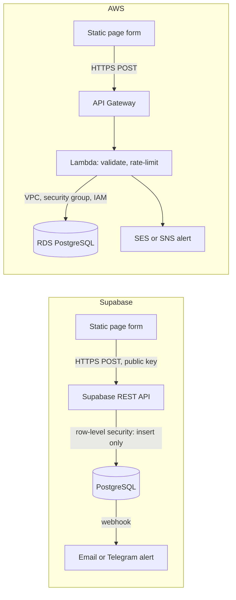

# Database Selection and Related Decisions: withyouseniors.in

| | |
|---|---|
| Status | Database verdict reached; implementation not started. Items marked "proposed" await owner confirmation. |
| Date | 2026-11-16 |
| Scope | Storing WhatsApp numbers and emails from visitors who ask for a WhatsApp call or an email |
| Final database verdict | **Supabase (managed PostgreSQL), Mumbai region** |

## How to read this document

Each decision follows the same pattern: the question, the options available, how they compare, and the verdict with the reasons behind it.

| # | Decision | Options considered | Verdict | Section |
|---|---|---|---|---|
| D1 | Which database to use | Supabase, Firebase Firestore, Google Sheets, form services, AWS RDS, own backend | **Supabase (PostgreSQL)** | 1 to 8 |
| D2 | How the page sends data to the database | Direct call to the database API, own API layer, form service, Apps Script | **Direct call, protected by row-level security** | 9 |
| D3 | Spam protection | Honeypot, Cloudflare Turnstile, Google reCAPTCHA, rate limiting, none | **Honeypot plus database rules now; Turnstile checked in an edge function if spam appears** | 10 |
| D4 | How the owners are alerted | Dashboard only, email, Telegram, WhatsApp Business API | **Email (proposed), Telegram optional** | 11 |
| D5 | Where the data is stored | Mumbai, Singapore, US or EU | **Mumbai** | 12 |
| D6 | Plan and uptime | Free plus keep-alive, Pro from day one, self-hosting | **Free for testing, Pro before real registrations** | 13 |

**Part A (sections 1 to 8): D1, database selection.**

## 1. Context

withyouseniors.in is a static site (HTML, CSS and JavaScript, served from GitHub Pages with a `CNAME`). There is no server of our own. We want visitors to register their WhatsApp number and email so we can call or email them, and we want the owners to see new registrations immediately.

Because the site is static, the database has to be reachable directly from the visitor's browser over HTTPS, or through a small hosted API in front of it. Browser-visible keys can never be secret, so access control must live in the database itself.

## 2. Requirements

| # | Requirement | Priority |
|---|---|---|
| R1 | Save a registration quickly (target: well under one second) | Must |
| R2 | Read new registrations immediately (dashboard, export, optional alert) | Must |
| R3 | Work from a static site with no server of our own | Must |
| R4 | Public visitors can only add rows; they can never read, change or delete data | Must |
| R5 | Store explicit consent and its timestamp | Must |
| R6 | Support deletion and correction on request (the Privacy Policy promises this) | Must |
| R7 | Keep data in India if possible (DPDP Act 2023 alignment) | Should |
| R8 | Instant notification to the owners on each registration | Should |
| R9 | Low or zero cost at launch volume (tens to a few hundred registrations a month) | Should |
| R10 | Easy to move to another provider later | Could |

Data collected: name, WhatsApp number, email, preferred contact method (WhatsApp call or email), consent flag, created time, status. **No health information is collected by this form.**

## 3. Options evaluated

1. Supabase (managed PostgreSQL with an auto-generated REST API)
2. Firebase Firestore (managed NoSQL)
3. Google Sheets with Apps Script
4. Form-to-email services (Formspree, Web3Forms)
5. AWS RDS for PostgreSQL (or Postgres on EC2)
6. Own backend (Node plus a managed Postgres)

## 4. Cost comparison

Prices are in USD, checked on 2026-11-16 against the providers' own pricing pages unless marked. Taxes such as GST may be added.

| Option | Free tier | Paid tier | Notes |
|---|---|---|---|
| **Supabase** | $0: 500 MB database, unlimited API requests, 5 GB egress, 2 active projects. **Paused after 1 week of inactivity.** | **Pro from $25/month**: 8 GB disk, 250 GB egress, daily backups (7 days), never paused. $10/month compute credit covers one Micro project; extra projects add their own compute. | Spend cap is on by default. Medium compute (4 GB, shared) is $60/month; Large (8 GB, dedicated 2 vCPU) is $110/month. |
| **Firebase Firestore** | $0 (Spark plan, no card): 1 GiB stored, 20K writes/day, 50K reads/day, 10 GiB egress/month | Blaze (pay-as-you-go), with a $300 credit if eligible | Cloud Functions (needed for automatic alerts) are not available on Spark; they need Blaze. |
| **Google Sheets + Apps Script** | $0 (not re-verified) | None needed | Slower (typically 1 to 3 seconds); not a real database. |
| **Formspree** | $0: 50 submissions/month | Personal $10 to $15/month (200 submissions), Professional $20 to $30/month (2,000), Business $60 to $90/month. The lower figure is the yearly-billed rate. | Email inbox plus dashboard, not a queryable database. The Free plan includes Email, Telegram, Slack and WhatsApp notification plugins, per the plugin table. |
| **Web3Forms** | $0: 250 submissions/month, stored up to 3 years | Paid plan; price not retrieved | Email inbox, not a database. |
| **AWS RDS for PostgreSQL** | New AWS accounts: up to $200 credits over 6 months; the free-plan account closes after 6 months or when credits run out | db.t4g.micro is $0.016/hour in the cheapest region and $0.021/hour in Mumbai (about $12 to $15/month) **before** storage, backups and data transfer | Needs an API layer (Lambda plus API Gateway or a server) for a static site. RDS's own pricing page could not be loaded; instance prices come from Vantage's instance table. |
| **Own backend** | Some free Postgres tiers (not re-verified) | Roughly $5 to $10/month hosting (not re-verified), plus engineering time | Most control, most maintenance. |

Always-on extras, whichever database is chosen: spam check with Cloudflare Turnstile (free, not re-verified); email alerts via a service such as Resend (free tier, not re-verified). WhatsApp alerts need the WhatsApp Business API, which charges per message; current rates were not checked.

## 5. Evaluation against the requirements

| Requirement | Supabase | Firestore | Sheets | Form service | AWS RDS | Own backend |
|---|---|---|---|---|---|---|
| R1 Fast save | Yes (milliseconds) | Yes | Slower | Fast | Yes, but via an API layer | Yes |
| R2 Fast read | Yes (SQL, dashboard, CSV) | Yes (realtime) | Sheet view | Inbox/dashboard | Yes | Yes |
| R3 Works from a static site | **Yes, direct REST** | Yes (SDK) | Yes | Yes | **No, needs an API layer** | Yes |
| R4 Insert-only for visitors | **Yes (row-level security)** | Yes (security rules) | **Weak** (public script URL) | Managed | Via the API layer | Via code |
| R5 Consent stored | Yes (columns) | Yes | Yes | Partly | Yes | Yes |
| R6 Delete on request | Yes (SQL or dashboard) | Yes | Yes (manual) | Limited | Yes | Yes |
| R7 Data in India | Mumbai region (confirm when creating the project) | Mumbai region (confirm) | Google-controlled | Vendor-controlled (Web3Forms states AWS hosting) | Mumbai region | Depends on host |
| R8 Instant alert | Database webhook or trigger | Needs Blaze plan | Possible via script | Built in (email) | Extra build | Extra build |
| R9 Cost at launch | $0, then $25 | $0 | $0 | $0 | Credits, then paid | Paid |
| R10 Easy to move | Standard Postgres | Harder (NoSQL) | Easy | Export only | Standard Postgres | Depends |

## 6. Option analysis

### 6.1 Supabase (chosen)
- **Strengths:** real SQL database; a REST endpoint is generated automatically, so the form can post straight from the page; row-level security lets us make the public key insert-only; built-in dashboard, CSV export and webhooks; free to start; Mumbai region.
- **Weaknesses:** free projects pause after a week of inactivity; Pro is a fixed $25/month once we need reliability; some features (auth, storage, row-level security that uses `auth.uid()`, edge functions) are Supabase-specific and would need rework if we ever left.
- **Fit:** best match for R1 to R9.

### 6.2 Firebase Firestore
- **Strengths:** very fast; realtime updates; generous free tier; Mumbai region.
- **Weaknesses:** NoSQL, so exports and reporting are less natural; instant alerts need Cloud Functions, which need the paid Blaze plan and a card on file; harder to move away from.
- **Fit:** viable second choice; loses on alerts and portability.

### 6.3 Google Sheets with Apps Script
- **Strengths:** free; familiar.
- **Weaknesses:** slowest of the options; the public script URL has no real access rules; quotas; weakest story for a personal-data form.
- **Fit:** acceptable only as a throwaway prototype.

### 6.4 Form services (Formspree, Web3Forms)
- **Strengths:** fastest to set up; email notification built in; spam filtering.
- **Weaknesses:** an inbox rather than a database; submission caps (50 or 250 free per month); limited querying and retention control.
- **Fit:** good if we only wanted emails. Not enough for "a live database".

### 6.5 AWS RDS or EC2 Postgres
- **Strengths:** slightly cheaper raw compute at scale; fine-grained tuning; enterprise controls.
- **Weaknesses:** a static site cannot call RDS directly, so we would also have to build and pay for an API layer (Lambda plus API Gateway or a server); more setup (networking, security groups, backups); current free tier is credits that expire in 6 months; far more to maintain for a small team.
- **Fit:** overkill at this stage. Revisit if volume reaches enterprise scale.

### 6.6 Own backend
- **Strengths:** full control.
- **Weaknesses:** we would build and maintain authentication, validation, rate limiting and hosting ourselves.
- **Fit:** not justified for a contact form.

## 7. Supabase vs AWS RDS in detail

Both run standard PostgreSQL, so the real difference is **what surrounds the database** and **who runs it**. Figures are from the sources in section 18 unless marked "not verified".

### 7.1 Like-for-like scope

| Need on a static site | Supabase | AWS equivalent |
|---|---|---|
| Managed PostgreSQL | Included | Amazon RDS for PostgreSQL |
| Public HTTPS endpoint the browser can call | Included (auto-generated REST API) | Must be built: API Gateway plus Lambda, or a small server |
| Insert-only access for anonymous visitors | Row-level security policy | Written in the Lambda or server code, plus IAM and security-group rules |
| Dashboard to view and export rows | Included | RDS console shows the instance, not the rows; use a SQL client or build a view |
| Optional user login, file storage, realtime | Included | Cognito, S3, and a realtime service, each billed separately |

For this project, "RDS" really means **RDS plus an API layer**, and that is the fair comparison.

### 7.2 Architecture

### 7.3 Cost

| Item | Supabase | AWS RDS |
|---|---|---|
| Entry cost | Free plan: $0 (500 MB; pauses after 1 week idle) | New accounts: up to $200 credits over 6 months, then pay-as-you-go |
| Always-on small instance | Pro: **$25/month** (includes $10 compute credit for one Micro project) | db.t4g.micro (2 vCPU, 1 GB): $0.016/hour cheapest region, $0.021/hour Mumbai, about **$12 to $15/month**, compute only |
| Compute over a year, small instance | Pro: about $300 | Mumbai micro: about **$184** (0.021 x 8,760 hours); cheapest region: about $140. Storage, backups, data transfer and the API layer are extra. |
| Mid-size instance (4 GB) | Medium compute $60/month, so $25 + $60 - $10 credit = **$75/month** (shared compute) | db.t4g.medium (2 vCPU, 4 GB): hourly price not retrieved; the third-party figure of about $58 is **not verified** |
| API layer | Included | Lambda and API Gateway usage: not priced here (not verified); likely small at this volume, but it is extra work to build |
| Storage | 8 GB included on Pro, then $0.125/GB | Billed per GB-month (rate not retrieved) |
| Backups | Free plan: not included. Pro: daily, kept 7 days. Point-in-time recovery is a $100/month add-on. | Automated backups are an RDS feature; retention and pricing not verified here |
| Cost control | Spend cap on by default on Pro | Billed on usage; set AWS budget alerts yourself |

**Reading the numbers:** raw database compute is cheaper on AWS, but once the API layer, storage, backups and engineering time are counted, Supabase's flat $25 is cheaper in practice at our volume. At large scale the gap reverses.

### 7.4 Operations and effort

| Area | Supabase | AWS RDS |
|---|---|---|
| Time to a working form | Minutes to hours | Days (VPC, security groups, IAM, API, deployment) |
| Who patches and maintains Postgres | Supabase | AWS (managed), but you manage networking and the API layer |
| Connection handling | Built-in pooler | You manage connection limits, often via a proxy for Lambda |
| Monitoring | Dashboard with logs and usage | CloudWatch (configure it yourself) |
| Idle behaviour | Free projects pause after 1 week | Always on while it exists |
| Skills needed | SQL and basic JavaScript | AWS networking, IAM, serverless, plus SQL |

### 7.5 Security and compliance

| Area | Supabase | AWS RDS |
|---|---|---|
| Access model | Row-level security in the database; a public key is safe because it can only insert | Private network plus IAM and security groups; the API code enforces what visitors can do |
| Encryption | Provided by the platform | RDS offers encryption at rest and in transit (not verified here) |
| Compliance attestations | SOC 2 and ISO 27001 are listed on the **Team plan ($599/month)**; HIPAA is a paid add-on on Team and above; not on Free or Pro | AWS holds a broad set of attestations (not verified here) |
| Data residency | Mumbai region available (confirm when creating the project) | Mumbai region (ap-south-1) available |

Our form collects **no health information**, so the Team-plan attestations are not required for this use. Revisit if the data ever grows to include health records.

### 7.6 Scale and flexibility

| Area | Supabase | AWS RDS |
|---|---|---|
| Ceiling | Compute sizes up to 16XL on the published list | Larger instance families, read replicas and multi-region (not verified here) |
| Extensions and tuning | Postgres extensions available; limited hardware tuning | Finer control over parameters and hardware |
| Lock-in | Data is plain Postgres; auth, storage, edge functions and `auth.uid()` policies are Supabase-specific | Data is plain Postgres; Lambda, API Gateway and IAM design are AWS-specific |
| Moving between them | `pg_dump` and restore moves the data; Supabase-only features need rework | Same |

### 7.7 Scorecard for this project

Ratings: 3 = best fit, 1 = weakest fit.

| Criterion | Supabase | AWS RDS |
|---|---|---|
| Time to launch | 3 | 1 |
| Fit for a static site (no server of our own) | 3 | 1 |
| Total cost at launch volume (including the API layer) | 3 | 2 |
| Raw database price at large scale | 2 | 3 |
| Operational effort for a small team | 3 | 1 |
| Secure-by-default for a public form | 3 | 2 |
| Compliance attestations on low-cost plans | 1 | 3 |
| Scale ceiling and tuning | 2 | 3 |
| **Total** | **20** | **16** |

### 7.8 When AWS RDS would win
- We already run other infrastructure on AWS or have a backend that handles authentication and APIs.
- We need private network access only, with no public database endpoint.
- The product grows to enterprise traffic, multi-region setups, or needs heavy tuning.
- We start handling health information and need AWS's compliance programs and contracts.
- We receive AWS credits that make it cheaper in practice.

### 7.9 Conclusion of this comparison
For a static site that needs a registration form, **Supabase is the better fit now**: faster to launch, cheaper once everything needed is counted, and secure by default with an insert-only policy. AWS RDS is the better long-term home only if scale, compliance or existing AWS investment demand it, and because both are plain Postgres, moving later is realistic.

## 8. Final verdict

**Use Supabase (managed PostgreSQL), Mumbai region.**

1. It is the only option that gives us, together, millisecond saves and reads, a direct browser-to-database path, insert-only public access, a built-in dashboard with export, instant-alert hooks, and a free start.
2. AWS would cost more effort for the same result because a static site needs an extra API layer.
3. Firestore is close on speed but loses on portability and on alerts without a card on file.
4. Form services and Sheets are cheaper to set up but are not a database.

**Plan:** use the Free plan only while building and testing, with no real registrations. Move to **Pro ($25/month, about ₹2,100)** before collecting real registrations. The reasons are in D6 (section 13).

**Part B (sections 9 to 13): the other decisions that follow from the database choice.**

## 9. D2: How the page sends data to the database

**Question.** The site has no server of its own. How does the form get its data into the database safely?

**Options available**
1. Call the database's own REST API straight from the page (Supabase).
2. Put an API layer in front of the database (AWS Lambda plus API Gateway, or a small server).
3. Use a hosted form service (Formspree, Web3Forms) that receives the form and emails or stores it.
4. Post to a Google Apps Script web address that writes to a Google Sheet.

**Comparison**

| Criterion | 1. Direct to database API | 2. Own API layer | 3. Form service | 4. Apps Script |
|---|---|---|---|---|
| Code to write | A small script in the page | Page script plus API code and deployment | Add the form action | Page script plus Apps Script |
| Who enforces "insert only" | The database (row-level security) | Our API code | The service | Script logic; the web address is public |
| Extra cost | None | API usage and hosting (not priced here) | Free up to 50 (Formspree) or 250 (Web3Forms) submissions a month, then paid | None |
| Where the data lands | A real database | A real database | Their inbox and dashboard | A sheet |
| Where checks can be added later | An edge function | API code | Service settings | Script code |

**Verdict: option 1.**

**Why.** D1 chose a database that exposes a REST API and row-level security, so the page can post straight to it with no extra moving parts. The public key in the page is safe by design: visitors can only insert, only with consent, and only rows that pass the database rules. If abuse grows, an edge function can be placed in front later (see D3) without redesigning anything.

**Why not the others.** Option 2 adds build time and cost with no benefit at this volume. Option 3 gives an inbox, not a database we can query. Option 4 has no real access rules.

## 10. D3: Spam and abuse protection

**Question.** A public form attracts bots. How do we keep junk out of the database?

**Options available**
1. Honeypot field only (a hidden field that humans leave empty).
2. Cloudflare Turnstile (a challenge that is usually invisible).
3. Google reCAPTCHA.
4. Rate limiting in an edge function.
5. No protection.

**Comparison**

| Option | Effort | Visitor friction | Needs a server-side check | Cost | Protection level |
|---|---|---|---|---|---|
| 1. Honeypot | Very low | None | No | Free | Stops simple bots only |
| 2. Turnstile | Low | Usually little or none (not verified) | Yes: the token must be verified on the server (not re-verified) | Free (not re-verified) | Stronger |
| 3. reCAPTCHA | Low | Can show challenges | Yes | Free tier limits not checked | Strong |
| 4. Rate limit in an edge function | Medium | None | It is the server-side check | Supabase edge functions: 500,000 calls/month on Free, 2 million on Pro | Limits repeat submissions from one source |
| 5. None | None | None | No | Free | Open to junk rows that eat the 500 MB free limit |

**Verdict: honeypot, database constraints and a required consent checkbox at launch. Add Turnstile, verified in an edge function, only if spam appears.**

**Why.** Turnstile and reCAPTCHA both need a server-side check, which means building an edge function. That is not worth adding before there is a spam problem. At launch the honeypot stops the simplest bots, and the database rules (valid number and email, length limits, consent required) cap what a bot can insert. We review new rows in the dashboard and can delete junk.

## 11. D4: How the owners are alerted

**Question.** How do the owners find out the moment someone registers?

**Options available**
1. No alert; check the dashboard.
2. Email on each registration.
3. Telegram message.
4. WhatsApp message through the WhatsApp Business API.
5. A form service's notification plugins (only if a form service were used).

**Comparison**

| Option | Speed | Cost | Setup | Approval needed |
|---|---|---|---|---|
| 1. Dashboard only | Manual | Free | None | None |
| 2. Email | Seconds | Free tier of an email service (not verified) | Small: a database webhook or edge function plus an email service | None known |
| 3. Telegram | Seconds | Free (not re-verified) | Small: needs a Telegram bot | None |
| 4. WhatsApp Business API | Seconds | Per-message charges (not checked) | Largest | Business verification and message templates (not verified) |
| 5. Form-service plugins | Seconds | Formspree's plugin table lists Email, Telegram, Slack and WhatsApp as included on its free plan | None | Not applicable: this route was not chosen in D1 or D2 |

**Verdict (proposed): email alert at launch, Telegram as an optional extra, WhatsApp API later only if volume justifies it. The owners choose the final channel.**

**Why.** Email is instant, free at this volume, needs no approval, and is where the owners already work. Telegram is an easy second channel. The WhatsApp Business API is the heaviest option: per-message fees and approval for what is, at launch volume, a handful of messages a week.

## 12. D5: Where the data is stored

**Question.** Which region should the database run in?

**Options available:** Mumbai, Singapore, US or EU.

**Comparison**

| Factor | Mumbai | Singapore | US or EU |
|---|---|---|---|
| Matches the Privacy Policy ("our records are held in India") | **Yes** | No | No |
| DPDP Act alignment (data kept in India) | Strongest | Weaker | Weaker |
| Distance for visitors in India | Shortest | Longer | Longest |
| Distance for families abroad (the people filling the form) | Longer than a US or EU region | Longer | Shortest |
| Offered by Supabase | Mumbai region listed by Supabase; confirm in the dashboard when creating the project | Yes (not re-verified) | Yes (not re-verified) |

**Verdict: Mumbai.**

**Why.** Our published Privacy Policy says records are held in India; choosing Mumbai keeps that statement true. Most registrants are families abroad, so their distance to the server is a little longer, which is acceptable for a one-time form submission (latency was not measured). If Mumbai is not offered when the project is created, Singapore is the fallback and the Privacy Policy wording must change. Visitors in the UK or EU may bring GDPR considerations; get legal advice before launch.

## 13. D6: Plan and uptime

**Question.** Which Supabase plan do we run, and when?

**Options available**
1. Free plan with a weekly keep-alive ping.
2. Free plan with no ping.
3. Pro plan from day one.
4. Self-host Supabase.

**Comparison**

| Factor | 1. Free + ping | 2. Free, no ping | 3. Pro | 4. Self-host |
|---|---|---|---|---|
| Cost | $0 | $0 | $25/month (about ₹2,100) | Free software; we pay for and run a server |
| Pauses after 1 week of inactivity | Avoided if pings count as activity (not verified; test it) | **Yes** | **Never** | No |
| Automatic backups | **Not included** | **Not included** | Daily, kept 7 days | Our responsibility |
| Spend cap | Not applicable | Not applicable | On by default | Not applicable |
| Effort | Low | None | None | High (Docker setup, patching, backups) |

**Verdict: use the Free plan with a weekly ping only for building and testing with test data. Move to Pro before collecting real registrations.**

**Why.** The Free plan has no automatic backups and can pause, which is acceptable for test data and unacceptable for real contact details. Pro costs $25 a month, never pauses and takes daily backups. Self-hosting trades that $25 for a server and ongoing maintenance, which is poor value for a small team.

**Part C (sections 14 to 18): implementation notes for the chosen design.**

## 14. Design (to be built)

### 14.1 Data model

One table, `registrations`. Each row is **either** a WhatsApp call request **or** an email request, never both. The full definition is in `supabase/schema.sql`.

| Column | Type | Rules |
|---|---|---|
| `id` | uuid | primary key, generated by the database |
| `created_at` | timestamptz | default `now()` |
| `contact_method` | text | `whatsapp_call` or `email` only |
| `name` | text | required for WhatsApp requests, 1 to 100 characters |
| `whatsapp` | text | required for WhatsApp requests; international format such as `+15550101234` |
| `email` | text | required for email requests; valid format, up to 254 characters |
| `message` | text | required for email requests, up to 1,000 characters |
| `consent` | boolean | must be `true` to insert |
| `consent_at` | timestamptz | default `now()` |
| `status` | text | `new`, `contacted`, `closed`; default `new`; visitors cannot set it |

### 14.2 Security

- Row-level security on. A single policy lets the public (anonymous) role **insert only**, and only when `consent` is true. No select, update or delete for the public role.
- The browser sends the insert with a "return nothing" preference, so no read access is ever needed.
- The public key is safe in the page because of the policy above. The service key is never placed in the page.
- Spam: a hidden honeypot field, and Cloudflare Turnstile if needed.
- Validation in both the page and the database constraints.

### 14.3 Compliance (DPDP Act 2023)
- Collect only what is needed (name, WhatsApp, email, preferred contact).
- Require an explicit consent checkbox and store when consent was given.
- Add a short note to the Privacy Policy covering this form.
- Honour deletion and correction requests (delete the row on request).
- Choose the Mumbai region when creating the project.
- Do not collect health information in this form.

### 14.4 Alerts
- A database webhook triggers an email to the owners on each new row.
- A Telegram alert can be added for free.
- WhatsApp alerts need the paid WhatsApp Business API and approval; not planned for now.

## 15. Risks and mitigations

| Risk | Mitigation |
|---|---|
| Free project pauses after a week of inactivity, and has no automatic backups | Free plan for test data only; Pro before real registrations (D6) |
| Spam or fake registrations | Honeypot, database constraints and dashboard review at launch; add Turnstile verified in an edge function if spam appears (D3) |
| Personal data exposure | Insert-only policy; no public reads; service key never in the page |
| Leaving Supabase later | Keep the data layer plain Postgres; avoid Supabase-only features for this table |
| Prices change | Re-check the pricing pages before upgrading |

## 16. Notes on an external comparison (Supabase vs AWS)

A third-party write-up comparing Supabase and AWS was reviewed. Its conclusion matches this verdict, but some figures should not be reused:

| Claim | Finding |
|---|---|
| Supabase free and Pro limits | Correct |
| Supabase mid-tier about $67 for "2 vCPU, 4 GB, 50 GB" | Does not match the pricing page: Medium (4 GB, shared compute) is $60 compute, so about $75 with the Pro fee and credit, and about $80 with 50 GB of disk. Dedicated 2 vCPU is the 8 GB Large size at $110. |
| AWS 12-month free micro database | Outdated for new accounts; now up to $200 credits over 6 months |
| AWS micro about $12 to $15/month | Roughly right for compute only; storage and backups are extra |
| "No vendor lock-in" | Data moves easily; Supabase-specific features would need rework |
| Not mentioned | A static site cannot call RDS directly without an extra API layer |

## 17. Open items before implementation

1. Confirm the region (D5): Mumbai when creating the Supabase project; if it is not offered, decide on Singapore and update the Privacy Policy wording.
2. Confirm the alert channel (D4): email proposed, Telegram optional, or none.
3. Owner creates the Supabase project and supplies the project URL and public (anon) key.
4. Update the Privacy Policy to mention this form.
5. Decide which page gets the form (currently `index2.html`).
6. Test whether a weekly ping keeps a free project awake, and decide when to move to Pro (D6).

## 18. Sources
- Supabase pricing: https://supabase.com/pricing
- Firebase pricing: https://firebase.google.com/pricing
- Formspree plans: https://formspree.io/plans
- Web3Forms: https://web3forms.com
- AWS Free Tier: https://aws.amazon.com/free/
- AWS instance prices (Vantage): https://instances.vantage.sh/aws/rds/db.t4g.micro
